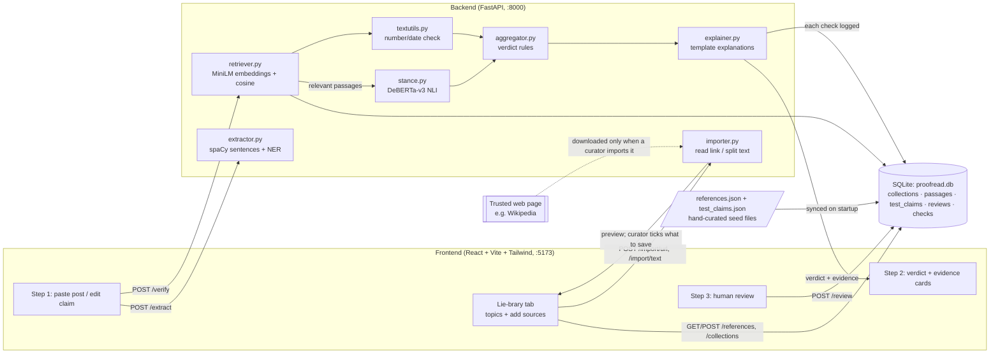

# Proofread

**Read it for proof before you share it.**

> **Run it locally with one command:** `./start.sh`, which opens http://localhost:8000. **Deploy it as a website:** see [section 7](#7-deploying-as-a-website).

Proofread is an AI-assisted claim review aid for a student media club. A reviewer pastes a social media post. Proofread picks out one factual claim and checks it against a small, curated set of trusted reference passages. It then shows the evidence, with source links and a plain-English explanation for every passage.

> ⚠️ Proofread is a **decision aid for human reviewers, not a fact checker.** Verdicts come only from the curated references and may be wrong. **Absence of evidence ≠ false.**

> 📌 **Before any demo:** every reference passage in `backend/data/references.json` is a paraphrased summary written for this prototype. **Manually open every URL and check that each passage matches its source.** The URLs were checked to load (HTTP 200) when the corpus was created. The wording of the passages has not been independently verified against the sources.

---

## 1. Problem statement

Misleading "facts" spread fast on social media, often wrapped in emoji, hashtags and opinions. Student journalists need a quick way to:

1. isolate the one checkable claim in a post,
2. see what trusted sources say about it, and
3. record a human decision, without the tool pretending to know the truth.

Proofread does this for **any topic**. Reviewers create a topic (e.g. "Climate change", "Elections 2026") and add trusted sources to it: paste a link, paste text, or type a passage. Claims are then checked against that topic's passages. A built-in example topic, the **Chandrayaan-3** Moon mission, comes with 20 hand-written passages and 14 labelled test claims. It follows three rules it never breaks:

- verdicts come **only** from the supplied passages, never from a model's world knowledge;
- a claim is never called false just because nothing matched (that is **INSUFFICIENT EVIDENCE**);
- a human always makes the final call.

## 2. Architecture



In the normal setup, **one server** (FastAPI on port 8000 locally, 7860 when deployed) serves both the web UI (the built React app) and the API, so the project runs as a single website. The Vite dev server on 5173 is only used in developer mode (`./start.sh dev`).

### Data storage (SQLite)

All runtime data lives in one SQLite file, `backend/data/proofread.db`. It is created automatically and needs no database server.

| table | contents | written by |
|---|---|---|
| `collections` | topics, e.g. "Chandrayaan-3", "Eiffel Tower" | built-in topic from the code; others via the Lie-brary tab |
| `passages` | reference passages, each belonging to one topic | built-in ones synced from `data/references.json` on every startup (`origin = seed`, read-only in the app); your own via the Lie-brary tab (`origin = user`, editable) |
| `test_claims` | the 14 labelled test claims (Chandrayaan-3 topic) | synced from `data/test_claims.json` on every startup |
| `reviews` | every human review (claim, model verdict, reviewer verdict, note, agreed, time) | `POST /review` |
| `checks` | every claim checked (verdict, confidence, top passage, time) | `POST /verify` |

The built-in corpus stays in JSON on purpose: it is easy to edit and review by hand. To change a built-in passage, edit the JSON and restart, and the database updates itself. The sync only touches built-in rows, so passages you add in the app are never overwritten. Your topics, your passages, reviews and check history exist only in the database. Inspect them with `sqlite3 backend/data/proofread.db "select * from reviews"`, or in the app's **History** tab.

### Project layout

```
proofread/
  start.sh              ONE command: setup + build + run (also: dev, eval, setup)
  Dockerfile            whole app in one container (used for deployment)
  backend/
    app/main.py         FastAPI app: API endpoints + serves the built UI
    app/db.py           SQLite database (topics, passages, test claims, reviews, check history)
    app/importer.py     read a web page / pasted text and split it into passages
    app/pipeline.py     loads models once, wires the steps together (used by API and evaluate.py)
    app/extractor.py    claim extraction
    app/retriever.py    embeddings + cosine similarity
    app/stance.py       NLI stance
    app/aggregator.py   verdict rules + mismatch nudge
    app/explainer.py    template explanations
    app/textutils.py    text cleaning, keyword overlap, number/date extraction
    app/config.py       every threshold in one place
    data/references.json   20 built-in passages (16 Chandrayaan-3 + 4 distractors), seed data
    data/test_claims.json  14 labelled test claims, seed data
    data/proofread.db      SQLite database, created automatically (not committed)
    download_models.py     pre-downloads the AI models (used by the Dockerfile)
    evaluate.py
    results/               eval_results.csv, eval_report.md
    requirements.txt
  frontend/             Vite + React + TypeScript + Tailwind
  README.md
```

### Using Proofread for any topic

1. Open the **Lie-brary** tab and click **+ New topic**. Give it a name and, optionally, a description.
2. Add trusted sources to it in one of three ways:
   - **Paste a link.** Proofread downloads the page and keeps its readable paragraphs. Wikipedia links use Wikipedia's own API for clean text. It splits the page into passages of about 3 sentences, never crossing a section, each titled "Page title: Section". Long pages are capped at 80 passages.
   - **Paste text.** The same splitting, for text copied from anywhere (e.g. a PDF report).
   - **Type one passage** by hand.
3. Imports are only a **preview**. Untick anything that isn't a clear factual statement (opinions, quotes, menus), then click **Save**. A human always decides what enters the reference set.
4. On **Check a claim**, choose the topic (or **All topics**) and check claims as usual.

New passages are searchable immediately: their embeddings are computed on first use and cached. The internet is used only when a curator imports a link. Claims are never checked against the live web.

**Safety of link imports:** only public `http(s)` addresses are fetched (localhost and private-network addresses are refused, including after redirects), with a 3 MB size limit and a 15-second timeout. Pages that block automatic downloads, or PDFs, should be copied and pasted instead.

## 3. Pipeline, step by step

| Step | File | What happens |
|---|---|---|
| 1. Clean | `textutils.clean_text` | Remove URLs, @mentions, #hashtags. Emoji are turned into sentence breaks, because posts often use them instead of full stops. |
| 2. Extract | `extractor.py` | spaCy splits the post into sentences. It **discards** questions, opinions/hedges ("I think", "I feel", "maybe", "in my opinion", …) and sentences under 5 words, and drops lead-ins like "Fun fact:". Remaining sentences are **scored**: 2 × fact-like named entities (DATE, CARDINAL, PERCENT, GPE, ORG, PERSON, EVENT, …) + 1 × numbers + 1 × factual verbs (up to 2) − 1.5 × hype words. The top sentence is the claim; all candidates are returned with scores and reasons so the user can pick another. |
| 3. Retrieve | `retriever.py` | Every passage is embedded once at startup with `all-MiniLM-L6-v2`. The claim is embedded, and the **top 3** passages by cosine similarity are returned. A passage is **relevant** only if similarity ≥ **0.45**. |
| 4. Stance | `stance.py` | For each relevant passage, the NLI cross-encoder `cross-encoder/nli-deberta-v3-small` reads *premise = passage*, *hypothesis = claim* and outputs softmax probabilities for entailment / contradiction / neutral. The label order is read from the model's `config.id2label` (for this model it is `contradiction, entailment, neutral`), not hard-coded. |
| 5. Number/date check *(heuristic 1)* | `textutils.compare_quantities` | Years, day-month dates and numbers (incl. words like "six", ordinals like "fourth", "a hundred") are pulled from claim and passage, each with **anchor words** from the dependency parse (e.g. "launched on 14 July" → anchor *launch*). If a relevant passage gives a **different value for the same anchor**, it is flagged as a mismatch. Up to **0.35** probability is then moved into "contradiction" (from entailment first, then neutral). |
| 6. Event-alignment gate *(heuristic 2)* | `pipeline.py` | A "contradicts" stance only counts if the passage uses one of the claim's main verbs (e.g. *land*, *launch*) or a mismatch was found. Otherwise the passage most likely describes a **different event**, and the contradiction is discarded. This gate can only remove a contradiction, never create one. |
| 7. Rules | `aggregator.py` | See below. |
| 8. Explain | `explainer.py` | Template sentences: similarity vs threshold, shared terms, matching/mismatching numbers, NLI label + probability, any heuristic that fired, and the final judgement. |

## 4. Why retrieval + NLI?

- **Retrieval** answers *"which passages are about this?"* It is cheap, and the relevance threshold gives a principled way to say "nothing covers this" instead of forcing a verdict.
- **NLI** answers *"does this passage agree with the claim?"* Because the model only ever compares two pieces of text, the verdict is grounded in the references. It never draws on what a generative model "remembers".
- Neither is enough alone. Similarity can't tell "landed on 23 August" from "landed on 15 August" (they are almost identical in meaning-space). NLI on an irrelevant passage produces confident nonsense.
- Everything runs locally on a laptop (MPS on Apple Silicon, otherwise CPU). There are no API keys, and posts never leave the machine.

## 5. Verdict rules

| Condition | Verdict |
|---|---|
| No passage clears the relevance threshold | **INSUFFICIENT_EVIDENCE**: "No reference passage covers this claim. This does NOT mean the claim is false." |
| Per passage: entailment ≥ 0.6 | passage *supports* |
| Per passage: contradiction ≥ 0.6 (after heuristics) | passage *contradicts* |
| Per passage: otherwise | passage *insufficient* |
| ≥1 supports, 0 contradicts | **SUPPORTED** |
| ≥1 contradicts, 0 supports | **CONTRADICTED** |
| both | **CONFLICTING**: needs human review (confidence forced to Low) |
| neither | **INSUFFICIENT_EVIDENCE** |

**Confidence** = the highest probability, among relevant passages, of the label behind the verdict (best entailment for SUPPORTED, best contradiction for CONTRADICTED, best neutral for INSUFFICIENT). It is labelled **High** ≥ 0.85, **Medium** ≥ 0.70, else **Low**. With no relevant passage there is no confidence score, and it shows as Low. Note that NLI probabilities are *not calibrated*: "100%" means the model is very sure, not that it is right.

All thresholds live in `backend/app/config.py` and can be overridden with environment variables (e.g. `PROOFREAD_RELEVANCE_THRESHOLD=0.5`).

## 6. Running it locally (macOS, Apple Silicon)

### The easy way: one command

```bash
cd proofread
./start.sh
```

That's it. The script installs anything missing (Python 3.11, the packages, the spaCy model, the Node packages), builds the web UI, starts the server and opens **http://localhost:8000** in your browser. The first run takes several minutes because it downloads ~640 MB of AI models. Later runs start in about 15–20 seconds. Press **Ctrl+C** to stop.

| command | what it does |
|---|---|
| `./start.sh` | run the full website on http://localhost:8000 |
| `./start.sh dev` | developer mode: API with auto-reload + UI with hot reload on http://localhost:5173 (Ctrl+C stops both) |
| `./start.sh eval` | run the evaluation (`./start.sh eval --sweep` adds the sensitivity table) |
| `./start.sh setup` | install and build only |

Requirement: **Node 18+** (https://nodejs.org). Python 3.11 is installed automatically if it's missing.

### The manual way (what `start.sh` does for you)

If you don't have Python 3.11 (macOS ships 3.9), the easiest route without Homebrew is:

```bash
python3 -m pip install --user uv
~/Library/Python/3.9/bin/uv python install 3.11
# python3.11 is now at: $(~/Library/Python/3.9/bin/uv python find 3.11)
```

### Backend

```bash
cd proofread/backend
python3.11 -m venv .venv          # or: "$(~/Library/Python/3.9/bin/uv python find 3.11)" -m venv .venv
source .venv/bin/activate
pip install -r requirements.txt
python -m spacy download en_core_web_sm
uvicorn app.main:app --reload --port 8000
```

The first start downloads the two Hugging Face models (~640 MB), which can take several minutes. Later starts take about 10–20 seconds. Check it's up: `curl localhost:8000/health`.

### Frontend

Either build it once so the backend serves it on http://localhost:8000:

```bash
cd proofread/frontend
npm install
npm run build
```

or run the Vite dev server with hot reload (in a second terminal) and open **http://localhost:5173**:

```bash
npm run dev
```

To point the UI at a different backend URL, set `VITE_API_URL` in `frontend/.env`.

### API quick reference

| Method | Path | Body | Returns |
|---|---|---|---|
| GET | `/health` | | status, device, models |
| GET | `/collections` | | all topics with passage counts |
| POST | `/collections` | `{name, description}` | creates a topic |
| DELETE | `/collections/{id}` | | deletes a user topic and its passages |
| GET | `/references?collection_id=` | | passages (all, or one topic) |
| POST | `/references` | `{collection_id, passages: [{title, source, url, date, text}]}` | saves passages to a topic |
| PUT / DELETE | `/references/{id}` | `{title?, source?, url?, date?, text?}` | edits / deletes a user passage (built-in ones are read-only) |
| POST | `/import/url` | `{url}` | preview of passages read from a web page (nothing saved) |
| POST | `/import/text` | `{text, title, source, url, date}` | preview of passages split from text (nothing saved) |
| GET | `/examples?collection_id=` | | test claims (for the "Load example" dropdown) |
| POST | `/extract` | `{post_text}` | `{claim, candidates[]}` |
| POST | `/verify` | `{claim, collection_id}` (`null` = all topics) | `{claim, verdict, confidence, confidence_label, summary, evidence[], thresholds, disclaimer}` |
| POST | `/review` | `{claim, model_verdict, reviewer_verdict, note}` | saves a review to the database |
| GET | `/review-log` | | all reviews |
| GET | `/history?limit=50` | | most recent checks |
| GET | `/stats` | | counts: passages, checks, reviews, agreement |

Interactive API docs are at **http://localhost:8000/docs**.

```bash
curl -s -X POST localhost:8000/verify -H 'Content-Type: application/json' \
  -d '{"claim":"India became the third country to soft-land on the Moon."}' | python -m json.tool
```

## 7. Deploying as a website

The `Dockerfile` packages everything (UI, API, AI models, SQLite) into one container. The recommended free host is **Hugging Face Spaces**, because the AI models need ~2 GB of RAM. Its free CPU tier has 16 GB RAM and needs no paid API keys. Many other free hosts (e.g. Render's free tier at 512 MB) cannot load PyTorch and the models.

### Step by step (Hugging Face Spaces)

1. Create a free account at https://huggingface.co/join.
2. Create a Space at https://huggingface.co/new-space: pick a name (e.g. `proofread`), choose **Docker** → **Blank** as the SDK, hardware **CPU basic (free)**, and set visibility as you like.
3. Create an access token with **write** permission at https://huggingface.co/settings/tokens.
4. Push the project (from the `proofread/` folder, which is a git repository):

   ```bash
   git remote add space https://huggingface.co/spaces/<your-username>/proofread
   git push space main
   # username = your Hugging Face username, password = the write token from step 3
   ```

5. The Space builds the image (about 5–10 minutes the first time) and then serves the site at `https://<your-username>-proofread.hf.space`. Any later `git push space main` redeploys automatically.

The YAML block at the top of this README tells Hugging Face to use Docker on port 7860.

### What to know about the deployed site

- **Database persistence:** on the free tier the container's disk is temporary. Reviews and check history are **lost whenever the Space restarts or redeploys** (passages and test claims always come back, because they are rebuilt from the JSON). For permanent storage, enable a Space persistent disk (paid). The container automatically puts the database at `/data/proofread.db` when one is mounted.
- **Sleeping:** free Spaces go to sleep after a period without visitors. The next visitor waits about 30–60 seconds while it wakes up and loads the models.
- **Speed:** on the free 2-CPU machine a check takes roughly a second or two (on a Mac with MPS it is faster).
- **Public reviews:** anyone with the link can submit reviews. There is no login. Make the Space private if only club members should use it.

### Running the container anywhere else

Any host that runs Docker containers with ≥ 2 GB RAM works (a cloud VM, Google Cloud Run, Fly.io, Railway; these are usually paid):

```bash
docker build -t proofread .
docker run -p 7860:7860 proofread        # open http://localhost:7860
```

## 8. Running the evaluation

```bash
cd proofread
./start.sh eval               # writes backend/results/eval_results.csv and eval_report.md
./start.sh eval --sweep       # also prints a relevance-threshold / top_k sensitivity table
```

(Equivalent manual commands: `cd backend && source .venv/bin/activate && python evaluate.py [--sweep]`.)

For every test claim, the script (a) runs extraction on the post and checks it found the intended claim, (b) verifies the **gold** claim, and (c) verifies the **extracted** claim (end-to-end).

## 9. Evaluation results

14 test claims: 5 SUPPORTED, 5 CONTRADICTED, 4 INSUFFICIENT_EVIDENCE. This includes two tricky ones: T13 (a paraphrase that should still support) and T14 (a subtle number change).

- Verification accuracy (gold claim): **13/14 = 93%**
- End-to-end accuracy (extracted claim): **13/14 = 93%**
- Extraction found the intended claim: **14/14** (13 exact, 1 with extra words)

| class | precision | recall | F1 | support | predicted |
|---|---|---|---|---|---|
| SUPPORTED | 1.00 | 1.00 | 1.00 | 5 | 5 |
| CONTRADICTED | 1.00 | 0.80 | 0.89 | 5 | 4 |
| INSUFFICIENT_EVIDENCE | 1.00 | 1.00 | 1.00 | 4 | 4 |
| CONFLICTING | 0.00 | n/a | 0.00 | 0 | 1 |

| expected \ predicted | SUP | CON | INS | CNF |
|---|---|---|---|---|
| SUPPORTED | 5 | 0 | 0 | 0 |
| CONTRADICTED | 0 | 4 | 0 | 1 |
| INSUFFICIENT_EVIDENCE | 0 | 0 | 4 | 0 |
| CONFLICTING | 0 | 0 | 0 | 0 |

| id | claim | expected | predicted | confidence | top passage |
|---|---|---|---|---|---|
| T01 | Chandrayaan-3 was launched on 14 July 2023 from Sriharikota. | SUPPORTED | ✅ SUPPORTED | 0.93 (High) | CY3-02 Launch of Chandrayaan-3 from Sriharikota |
| T02 | The Vikram lander touched down near the Moon's south pole on 23 August 2023. | SUPPORTED | ✅ SUPPORTED | 1.00 (High) | CY3-05 Vikram lander touches down near the lunar south pole |
| T03 | The Pragyan rover confirmed the presence of sulphur on the lunar surface. | SUPPORTED | ✅ SUPPORTED | 0.99 (High) | CY3-10 Sulphur detected on the lunar surface by Pragyan |
| T04 | India became the first country to land near the lunar south pole. | SUPPORTED | ✅ SUPPORTED | 0.76 (Medium) | CY3-06 India's place in lunar landing history |
| T05 | Chandrayaan-3 landed on the Moon on 15 August 2023. | CONTRADICTED | ✅ CONTRADICTED | 1.00 (High) | CY3-04 Lunar orbit insertion and lander separation |
| T06 | The rover deployed by Chandrayaan-3 was named Pragati. | CONTRADICTED | ❌ CONFLICTING | 1.00 (Low) | CY3-08 Pragyan rover |
| T07 | Chandrayaan-3 landed near the Moon's north pole. | CONTRADICTED | ✅ CONTRADICTED | 1.00 (High) | CY3-05 Vikram lander touches down near the lunar south pole |
| T08 | The Pragyan rover has four wheels and carried two instruments. | CONTRADICTED | ✅ CONTRADICTED | 1.00 (High) | CY3-08 Pragyan rover |
| T09 | The Chandrayaan-3 mission cost less than the budget of the movie Interstellar. | INSUFFICIENT_EVIDENCE | ✅ INSUFFICIENT_EVIDENCE | – (Low) | CY3-01 Chandrayaan-3 mission overview |
| T10 | The Pragyan rover found water ice at the Chandrayaan-3 landing site. | INSUFFICIENT_EVIDENCE | ✅ INSUFFICIENT_EVIDENCE | 1.00 (High) | CY3-08 Pragyan rover |
| T11 | The Chandrayaan-3 mission was led by project director P. Veeramuthuvel. | INSUFFICIENT_EVIDENCE | ✅ INSUFFICIENT_EVIDENCE | 1.00 (High) | CY3-01 Chandrayaan-3 mission overview |
| T12 | Over 8 million people watched the Chandrayaan-3 landing live on YouTube. | INSUFFICIENT_EVIDENCE | ✅ INSUFFICIENT_EVIDENCE | 1.00 (High) | CY3-02 Launch of Chandrayaan-3 from Sriharikota |
| T13 | ISRO's Moon rover drove more than a hundred metres before going to sleep. | SUPPORTED | ✅ SUPPORTED | 0.99 (High) | CY3-12 Rover traverse and sleep mode |
| T14 | India became the third country to soft-land on the Moon. | CONTRADICTED | ✅ CONTRADICTED | 1.00 (High) | CY3-06 India's place in lunar landing history |

### Failure analysis

- **T06 ("rover named Pragati") → CONFLICTING instead of CONTRADICTED.** The NLI model says the Pragyan passage *entails* "the rover was named Pragati" with 99% probability. The names probably share sub-word tokens, so the model treats them as the same. The only "contradiction" came from the *lander* passage ("lander is named Vikram"), so even that half is right for a slightly wrong reason. The system at least routes this case to a human (CONFLICTING) rather than wrongly saying SUPPORTED. Fixing it properly needs an entity-level name check (see Future work).
- **T05** is correct, but note that the top-*similarity* passage is the lunar-orbit passage. The contradiction that counts comes from the landing passage further down the list. Date-heavy claims pull in other date-heavy passages.
- The mismatch heuristic sometimes compares across missions. For "Chandrayaan-3 was launched on 14 August 2023", it also flags Chandrayaan-**2**'s 22 July 2019 launch as a mismatch. NLI stayed neutral on that passage, so the verdict was unaffected, but it shows the heuristic doesn't know which mission a date belongs to.

### Sensitivity analysis (`--sweep`)

| relevance threshold | top_k=3 | top_k=5 |
|---|---|---|
| 0.35 | 13/14 | 13/14 |
| 0.45 | 13/14 | 13/14 |
| 0.55 | 13/14 | 13/14 |
| 0.65 | 12/14 | 12/14 |

### Changes after the first evaluation run (read this before quoting the numbers)

The **first** full run scored **9/14**. After inspecting the failures, three changes were made:

1. **Retrieval embeds passage text only** (previously title + text). With titles, date-heavy passages pushed the landing passage out of the top 3 for T05.
2. **Event-alignment gate (heuristic 2).** On T01, T02 and T11, the NLI model gave ~100% "contradiction" for passages about a *different event* (e.g. "entered lunar orbit on 5 August" vs a launch-date claim). This is a known NLI failure mode with multi-fact premises.
3. **Extraction cleanup.** Emoji become sentence boundaries, and lead-ins ending in ":" are dropped.

Thresholds (0.45 / 0.6 / 0.35) were **not** changed. Because the test set guided these fixes, **13/14 is an optimistic number.** As a small check on overfitting, six *new* claims written afterwards were all classified correctly:

| new claim | expected | got |
|---|---|---|
| Chandrayaan-3 was launched on 14 August 2023. | CONTRADICTED | CONTRADICTED |
| Chandrayaan-3 was launched by a PSLV rocket. | CONTRADICTED | CONTRADICTED |
| The Pragyan rover weighs about 26 kg. | SUPPORTED | SUPPORTED |
| The Vikram lander hopped about 40 cm on 3 September 2023. | SUPPORTED | SUPPORTED |
| Aditya-L1 is India's first solar observatory. | SUPPORTED | SUPPORTED |
| Chandrayaan-3 found oil on the Moon. | INSUFFICIENT_EVIDENCE | INSUFFICIENT_EVIDENCE |

Six claims is still far too few to estimate real-world accuracy.

### Trying a brand-new topic (Eiffel Tower)

To check that Proofread works beyond the built-in example, a new topic was created and the English Wikipedia article "Eiffel Tower" was imported through the app (80 passages, all kept). Ten claims were then written and checked:

| claim | expected | got |
|---|---|---|
| The Eiffel Tower is located in Paris. | SUPPORTED | SUPPORTED |
| The Eiffel Tower is located in London. | CONTRADICTED | CONTRADICTED |
| The Eiffel Tower was built between 1887 and 1889. | SUPPORTED | SUPPORTED |
| The Eiffel Tower was built for the 1889 World's Fair. | SUPPORTED | SUPPORTED |
| The Eiffel Tower is 500 metres tall. | CONTRADICTED | CONTRADICTED |
| The Eiffel Tower was painted pink in 2020. | INSUFFICIENT_EVIDENCE | INSUFFICIENT_EVIDENCE |
| The Eiffel Tower was designed by Gustave Eiffel's company. | SUPPORTED | CONFLICTING |
| The Eiffel Tower is 330 metres tall. | SUPPORTED | CONFLICTING |
| The Eiffel Tower is the tallest building in the world. | CONTRADICTED | CONFLICTING |
| (All topics) The Eiffel Tower is located in London. | CONTRADICTED | CONTRADICTED |

The three CONFLICTING results are genuinely nuanced, and they go to a human as intended:
- the design is credited both to "Eiffel's company" and to two engineers "working for" that company;
- the article gives several heights from different years;
- the tower *was* the world's tallest structure until 1930.

This testing also exposed a bug: the event-alignment gate discarded the correct contradiction for "is **located** in London", because the passage says "is … in Paris" and never uses "located". State verbs (*locate, situate, base, call, know, remain, …*) are now excluded from the gate, since the gate exists to separate *events*. The Chandrayaan-3 evaluation was re-run afterwards and is unchanged at 13/14.

## 10. Limitations

- **Only as good as its sources.** Proofread knows only the passages saved in a topic. Few or poor sources give few or poor verdicts, and anything not covered is INSUFFICIENT EVIDENCE by design.
- **Imported pages are treated as true.** A link import keeps a page's paragraphs automatically, including any opinions, quotes or outdated facts on it. Curators must untick those, and importing an untrustworthy page makes Proofread confidently wrong.
- **Accuracy on new topics is unmeasured.** The 14-claim evaluation covers only Chandrayaan-3; the Eiffel Tower check above is a 10-claim spot check, not an evaluation.
- **The NLI model may still lean on background knowledge.** For "The Eiffel Tower is in London", even passages that never mention Paris were scored as contradicting, which suggests the model "knows" where the tower is. The verdict only counts passages that cleared the relevance threshold, but this leak can't be fully ruled out.
- **NLI is weak on numbers, negation, look-alike names and multi-hop reasoning.** T06 shows the name problem. Claims that need two passages combined (e.g. "the rover operated for less than half a month") are not handled.
- **Heuristics can misfire.** The number/date check uses dependency-parse anchors and can compare the wrong things (e.g. across missions). The event-alignment gate uses exact verb lemmas, so synonyms ("touched down" vs "landed") don't count as alignment. It may wrongly drop a genuine contradiction stated with a different verb.
- **Threshold sensitivity.** Relevance 0.45, stance 0.6 and nudge 0.35 were set by hand; see the sweep above.
- **Uncalibrated confidence.** NLI probabilities are often ~100% even when wrong.
- **English only, one claim at a time.** Multi-claim posts get one claim; the rest are ignored unless the user picks them.
- **Corpus trust depends on curation.** Passages are paraphrases. A wrong passage gives confidently wrong verdicts. Every passage must be checked against its source.
- **No live updates.** Claims are never checked against the live web; new facts are invisible until a curator adds them to a topic.
- **Link import is basic.** It reads `<p>` paragraphs; pages built with JavaScript, paywalls and PDFs may import little or nothing (use "Paste text" instead).
- **Extraction heuristics may pick the wrong sentence**, e.g. sarcasm, or a claim phrased as a question ("Did you know Chandrayaan-3 landed…?" is discarded as a question). The user can always edit the claim.
- **Tiny, self-written test set** (see the caveat above).

## 11. Responsible use / human-in-the-loop

- The UI shows a **persistent banner**: *"Decision-support tool for human reviewers. Verdicts are based only on the curated reference set and may be wrong. Absence of evidence ≠ false."*
- Every verdict comes with the passages, links, scores and reasons, so a reviewer can **check the reasoning, not trust a badge**.
- **CONFLICTING** exists specifically to hand disagreements to a person.
- Step 3 asks the reviewer to **agree or override**. Every decision is saved in the database (`reviews` table) with the model's verdict, so the club can see where the tool fails.
- Do not publish a verdict without opening the sources. Do not use Proofread to label people or accounts.

## 12. Future work

- Entity-level checks for names (would fix T06): compare PERSON/PRODUCT/ORG entities between claim and passage.
- Sentence-level NLI (premise = best-matching sentence) and calibrated probabilities.
- A larger, versioned corpus with a curator workflow, plus provenance checks on each passage.
- Hybrid retrieval (BM25 + embeddings) so exact dates and names count more.
- Learn the thresholds from reviewer overrides in the review log, evaluated on a held-out set.
- Multi-claim posts, multilingual support (Hindi first), and claim decomposition for multi-hop claims.

## 13. Viva cheat sheet

- **Where are verdicts decided?** `backend/app/aggregator.py`. The rules are about 20 lines and are listed in section 5.
- **How do we avoid using model knowledge?** The NLI model only judges passage-vs-claim pairs, and with no relevant passage the answer is always INSUFFICIENT_EVIDENCE.
- **Why can't "no match" become "false"?** `aggregate()` returns CONTRADICTED only if a relevant passage's contradiction probability ≥ 0.6, and that contradiction must survive the event-alignment gate.
- **Where are thresholds?** `backend/app/config.py`.
- **What are the heuristics?** (1) number/date mismatch nudge (`textutils.compare_quantities` + `aggregator.apply_mismatch_nudge`); (2) event-alignment gate (`pipeline.py`). Both are documented as heuristics in the code and the explanations.
