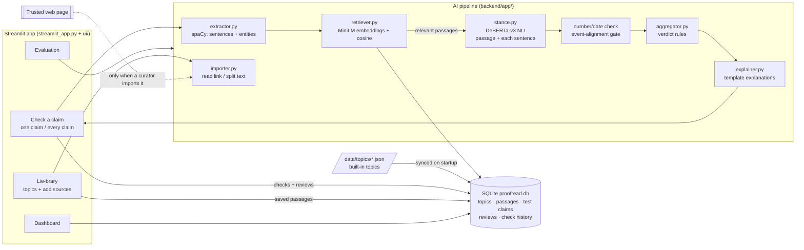

# Proofread

**Read it for proof before you share it.**

Proofread is an AI-assisted claim review aid for a student media club. A reviewer pastes a social media post. Proofread finds the factual claim (or every claim) in it and checks each one against a curated set of trusted reference passages. It shows the evidence with source links, highlighted words, the exact sentence that decided it and a plain-English explanation. A human then makes the final decision.

> ⚠️ Proofread is a **decision aid for human reviewers, not a fact checker.** Verdicts come only from the curated references and may be wrong. **Absence of evidence ≠ false.**

> 📌 **Before any demo:** the built-in passages in `backend/data/topics/` are paraphrased summaries written for this prototype. Their links load, and the Constitution and Cricket facts were spot-checked against Wikipedia, but **open every link and check each passage yourself** before relying on it.

**Run it:** `./start.sh` opens **http://localhost:8501**. **Deploy it:** see [section 8](#8-deploying-as-a-website).

---

## 1. Problem statement

Misleading "facts" spread fast on social media, wrapped in emoji, hashtags and opinions. Student journalists need a quick way to:

1. isolate the checkable claim(s) in a post,
2. see what trusted sources say about each one, and
3. record a human decision, without the tool pretending to know the truth.

Proofread follows three rules it never breaks:

- verdicts come **only** from the supplied reference passages, never from a model's world knowledge;
- a claim is never called false just because nothing matched (that is **INSUFFICIENT EVIDENCE**);
- a human always makes the final call.

## 2. What the app does (5 pages)

| Page | What you can do |
|---|---|
| **Check a claim** | Pick a topic, paste a post (or load an example). **One claim** mode: extract the claim, edit it, check it. **Every claim** mode: find every factual sentence and check each one. Each result shows a verdict, evidence cards (link, highlights, similarity, NLI scores, number/date warnings, the 🔑 key sentence, a "Why" explanation) and a human-review form. |
| **Lie-brary** | Browse the topics and passages. Create your own topic and add sources by **pasting a link** (Wikipedia or any web page, split into passages you tick before saving), **pasting text**, or **typing one passage**. Edit or delete your passages. |
| **Dashboard** | Live charts from the database: verdicts given, claims per day, model vs reviewer decisions, how often reviewers override each verdict, the most-used topics, sources and passages. |
| **Evaluation** | Results on the 14 test claims: accuracy, baselines vs Proofread, ablations, confusion matrix, confidence calibration, threshold sensitivity, multi-claim results, every claim, and what the results taught us. A button re-runs the evaluation. |
| **About & Limitations** | How it works, limitations, responsible use. |

Built-in topics: **Chandrayaan-3** (20 passages, including 4 distractors about other ISRO missions), **Constitution of India** (12) and **Cricket World Cup 2023** (12). You can add any other topic in the Lie-brary.

## 3. Architecture



Everything runs locally with open-source models. There are no paid APIs and no API keys.

### Project layout

```
proofread/
  start.sh                 ONE command: setup + run (also: eval, setup, web, dev)
  streamlit_app.py         the Streamlit app: header, banner, page navigation
  ui/                      one file per page + shared pieces
    check.py  library.py  dashboard.py  evaluation.py  about.py
    common.py              cached pipeline, verdict colours, evidence card, review form
    charts.py              chart helpers (Altair)
  requirements.txt         packages for deployment (Linux, CPU)
  Dockerfile               container for Hugging Face Spaces (backup host)
  .streamlit/config.toml   theme
  backend/
    app/pipeline.py        loads models once; verify(), check_post(); switches for ablations
    app/extractor.py       claim extraction (one claim, or every claim)
    app/retriever.py       embeddings + cosine similarity, cached per passage
    app/stance.py          NLI (label order read from the model config)
    app/aggregator.py      verdict rules + mismatch nudge
    app/explainer.py       template explanations
    app/textutils.py       text cleaning, keywords, number/date extraction
    app/importer.py        link / text import (safe downloading, splitting into passages)
    app/db.py              SQLite database
    app/config.py          every threshold in one place
    app/main.py            optional FastAPI server (used by the older React website)
    data/topics/*.json     built-in topics and their passages
    data/test_claims.json  the 14 labelled test claims
    data/multi_claim_tests.json  4 multi-claim test posts
    evaluate.py            evaluation (baselines, ablations, safety, multi-claim)
    results/               eval_summary.json, eval_results.csv, eval_report.md
    requirements.txt       packages for local use (Mac)
  frontend/                older React website (still works via ./start.sh web, lacks the newer features)
```

## 4. Pipeline, step by step

| Step | File | What happens |
|---|---|---|
| 1. Clean | `textutils.clean_text` | Remove URLs, @mentions, #hashtags. Emoji become sentence breaks, because posts often use them instead of full stops. |
| 2. Extract | `extractor.py` | spaCy splits the post into sentences. It **discards** questions, opinions/hedges ("I think", "maybe", "in my opinion"…), lead-ins ending in ":" and sentences under 5 words. The rest are **scored**: 2 × named entities (dates, places, people, organisations, numbers…) + 1 × numbers + 1 × factual verbs − 1.5 × hype words. **One claim** mode takes the top sentence; **every claim** mode takes each sentence scoring ≥ 2 (at most 6). |
| 3. Retrieve | `retriever.py` | Each passage of the chosen topic is embedded with `all-MiniLM-L6-v2` (cached, so new passages are searchable at once). The **top 3** by cosine similarity are returned; only those with similarity ≥ **0.45** count as relevant. |
| 4. Stance | `stance.py`, `pipeline.py` | `cross-encoder/nli-deberta-v3-small` reads *premise = passage*, *hypothesis = claim* and outputs entailment / contradiction / neutral. It also reads **each sentence** of the passage, to find the **key sentence** that decides the judgement. |
| 5. Number/date check *(heuristic 1)* | `textutils.compare_quantities` | Years, dates and numbers (including "six", "fourth", "a hundred") are extracted with the word they describe (e.g. "landed on 15 August" → *land*). A different value for the same thing is flagged ⚠, and up to 0.35 probability is moved towards "contradiction". |
| 6. Event-alignment gate *(heuristic 2)* | `pipeline.py` | A "contradicts" only counts if the passage uses one of the claim's main event verbs (e.g. *land*, *launch*) or a mismatch was found. Otherwise the passage most likely describes a different event, and the contradiction is discarded. State verbs (*located, known as…*) are ignored. This gate can only remove a contradiction, never create one. |
| 7. Rules | `aggregator.py` | See section 5. |
| 8. Explain | `explainer.py` | Template sentences: similarity vs threshold, shared words, matching or mismatching numbers, NLI label and probability, any heuristic that fired, and the judgement. |

**Why retrieval + NLI?** Retrieval answers *"which passages are about this?"*, and its threshold gives a principled way to say "nothing covers this". NLI answers *"does this passage agree?"*. Because the model only compares two texts, verdicts stay grounded in the references. Neither works alone: similarity can't tell "landed on 23 August" from "landed on 15 August", and NLI on irrelevant passages gives confident nonsense. The evaluation (section 7) measures exactly this.

## 5. Verdict rules

| Condition | Verdict |
|---|---|
| No passage clears the relevance threshold | **INSUFFICIENT_EVIDENCE** ("This does NOT mean the claim is false.") |
| Per passage: entailment ≥ 0.6 → *supports*; contradiction ≥ 0.6 → *contradicts*; otherwise *insufficient* | |
| ≥1 supports, 0 contradicts | **SUPPORTED** |
| ≥1 contradicts, 0 supports | **CONTRADICTED** |
| both | **CONFLICTING**: a human must decide (confidence forced to Low) |
| neither | **INSUFFICIENT_EVIDENCE** |

**Confidence** is the highest probability, among relevant passages, of the label behind the verdict: **High** ≥ 0.85, **Medium** ≥ 0.70, else **Low**. NLI probabilities are not calibrated, so "High" means "very sure", not "definitely right". All thresholds are in `backend/app/config.py`.

## 6. Running it locally (Mac)

```bash
cd proofread
./start.sh
```

That's it. The script installs anything missing (Python 3.11 via `uv` if needed, the packages, the spaCy model) and opens **http://localhost:8501**.
- **First run:** takes several minutes, because it downloads ~640 MB of AI models.
- **After that:** starts in seconds. Once the models are on disk, the app doesn't need the internet, so a demo works without wifi.
- **To stop:** press **Ctrl+C**.

| command | what it does |
|---|---|
| `./start.sh` | run the Streamlit app on http://localhost:8501 |
| `./start.sh eval` | run the evaluation (writes `backend/results/`) |
| `./start.sh setup` | install only |
| `./start.sh web` | the older React + FastAPI website on http://localhost:8000 (no multi-claim mode, key sentences, dashboard or evaluation page) |

All data lives in one SQLite file, `backend/data/proofread.db`, created automatically. It needs no database server. Built-in topics are synced from `backend/data/topics/*.json` at every start; your own topics, passages, reviews and check history are stored only in the database.

## 7. Evaluation

Run `./start.sh eval`, or press **Re-run evaluation** on the Evaluation page. It tests the **14 labelled claims** T01–T14 (Chandrayaan-3) and **4 multi-claim posts**. The claim mix is:
- 5 SUPPORTED;
- 5 CONTRADICTED (wrong date, name, place, number, ordinal);
- 4 INSUFFICIENT_EVIDENCE (plausible but not covered by the references);
- including two tricky ones: a paraphrase (T13) and a subtle number change (T14).

### Headline results

- **Accuracy: 13/14 = 93%** (macro-F1 0.96)
- **Not-covered claims wrongly called false: 0%** (the assignment's key rule)
- **Wrong or not-covered claims wrongly supported: 0%**
- End-to-end (claim extracted automatically from the post): 93%; extraction found the intended claim in 14/14 posts
- Multi-claim posts: found 100% of the 11 claims (92% of the sentences treated as claims were real claims); correct verdict for 82% of them
- Average time per claim: ~0.13 s (Apple M-series GPU)

### Proofread vs simpler methods (baselines) and with parts switched off (ablations)

| system | type | accuracy | macro-F1 | not-covered → false | wrongly supported |
|---|---|---|---|---|---|
| Keyword match | baseline | 57% | 0.49 | 0% | 67% |
| Similarity only | baseline | 57% | 0.46 | 0% | 33% |
| Plain NLI (no threshold, no heuristics) | baseline | 71% | 0.80 | **25%** | 0% |
| **Proofread (full)** | full | **93%** | **0.96** | **0%** | **0%** |
| − relevance threshold | ablation | 93% | 0.96 | 0% | 0% |
| − number/date check | ablation | 93% | 0.96 | 0% | 0% |
| − event-alignment gate | ablation | 71% | 0.80 | 25% | 0% |
| + sentence-level NLI | ablation | 86% | 0.93 | 0% | 0% |
| top_k = 1 | ablation | 86% | 0.85 | 0% | 11% |
| top_k = 5 | ablation | 93% | 0.96 | 0% | 0% |

The two simple baselines can never say "contradicted", so they never break the "not covered ≠ false" rule, but they wrongly support a third to two-thirds of false claims. Plain NLI catches contradictions but calls a quarter of uncovered claims false. Proofread is the only method that is both accurate and safe on these claims.

### What the results taught us

- **The event-alignment gate is the most important safety part.** Without it, accuracy drops to 71% and 25% of uncovered claims are called false.
- **NLI confuses look-alike names.** The single failure, T06 ("the rover was named **Pragati**"), comes out CONFLICTING: the model thinks the **Pragyan** passage agrees. The system sends it to a human instead of supporting it.
- **Passages must make sense on their own.** In the cricket multi-claim post, a passage saying "**the final** was played in Ahmedabad" never says *which* final, so the NLI model won't confirm a claim about the 2023 World Cup final. Writing self-contained ("decontextualised") passages is the clear next step.
- **Some parts made no difference here.** Removing the relevance threshold or the number/date check gives the same accuracy on these 14 claims. They still add the warnings and explanations reviewers see, but 14 claims is too few to show an effect.

### How honest are these numbers?

- **All 14 claims were seen while the system was being built**, and several design changes came from inspecting them. The first version scored 9/14. The changes were:
  - retrieval uses passage text only;
  - the event-alignment gate was added;
  - emoji and lead-ins are cleaned during extraction.

  So 93% is an **optimistic** figure.
- **A larger test was also run during development.** It had 50 claims, including 30 on the Constitution and Cricket topics, written and committed to git *before* the system was run on them. It scored **86% overall and 80% on those 30 unseen claims**, and most misses were the "passages must make sense on their own" problem above. That test set is in the git history (commit `ba1f5f1`). **Expect accuracy nearer 80% than 93% on new claims.**

Full details are in `backend/results/eval_report.md` and on the Evaluation page.

## 8. Deploying as a website

### Option A: Streamlit Community Cloud (free)

1. Put the `proofread` folder on GitHub: create a new repository, then `git remote add origin <its URL>` and `git push -u origin main`.
2. Go to https://share.streamlit.io, sign in with GitHub, and click **Create app**.
3. Choose your repository and branch `main`, and set the **main file path** to `streamlit_app.py`.
4. Open **Advanced settings** and choose **Python 3.11**.
5. Click **Deploy**. The first build takes several minutes, because it installs PyTorch and downloads the models. Later visits are fast.

It installs packages from the top-level `requirements.txt` (CPU-only PyTorch, the spaCy model, pinned versions).

What to know:
- **Memory.** Free Streamlit apps have limited memory (around 2.7 GB at last check). Proofread needs roughly 1.5 GB, so it should fit, but if the app crashes with a memory error, use option B.
- **Saved data resets.** The free tier's disk is temporary, so reviews, check history and topics you add are lost when the app restarts or sleeps. Built-in topics always come back.
- **Sleeping.** Apps sleep after a few days without visitors; the next visitor clicks "wake up" and waits a minute.
- **Public by default.** Anyone with the link can use it and submit reviews. You can make the app private in its settings.

### Option B: Hugging Face Spaces (free, more memory)

The `Dockerfile` runs the same Streamlit app with the models built into the image. Create a Space at https://huggingface.co/new-space with **Docker → Blank** and the free CPU hardware. Then:

```bash
git remote add space https://huggingface.co/spaces/<your-username>/proofread
git push space main          # password = a Hugging Face token with write access
```

The YAML block at the top of this README tells Hugging Face to use Docker on port 7860. The same notes about temporary storage and sleeping apply. (The Docker image was not built locally, because Docker isn't installed on the development machine.)

## 9. Limitations

- **Only as good as its sources.** Proofread knows only the passages saved in a topic. Anything not covered is INSUFFICIENT EVIDENCE by design.
- **Passages must make sense on their own** (see section 7). This caused most misses on unseen claims.
- **Imported pages are treated as true.** A link import keeps a page's paragraphs automatically, including opinions, quotes or outdated facts. The curator must untick those.
- **NLI is weak on numbers, negation, look-alike names and multi-hop reasoning**, and may still lean on its own background knowledge despite the relevance filter.
- **Heuristics can misfire.** The number/date check can compare values across missions; the gate uses exact verb matching, so synonyms ("touched down" vs "landed") don't count as the same event.
- **Threshold sensitivity.** Relevance 0.45, stance 0.6 and nudge 0.35 were set by hand. The Evaluation page shows how accuracy changes.
- **Uncalibrated confidence.** "High" means very sure, not correct.
- **English only.** Multi-claim mode handles at most 6 claims per post, and may treat a non-claim with a date in it as a claim.
- **No live updates.** Claims are never checked against the live web.
- **Small evaluation:** 14 claims, all seen during development (see section 7).
- **Known Streamlit quirk.** Opening a link straight to a sub-page in a brand-new session shows a harmless "Page not found" pop-up while the correct page loads underneath.

## 10. Responsible use / human-in-the-loop

- Every page shows the banner: *"Decision-support tool for human reviewers. Verdicts are based only on the curated reference set and may be wrong. Absence of evidence ≠ false."*
- Every verdict comes with passages, links, scores, the key sentence and reasons, so a reviewer can **check the reasoning, not trust a badge**.
- **CONFLICTING** exists to hand disagreements to a person.
- Reviewers agree or override every verdict. Decisions are saved and summarised on the Dashboard, so the club can see where the tool fails.
- Don't publish a verdict without opening the sources. Don't use Proofread to label people or accounts.

## 11. Future work

- Self-contained ("decontextualised") passages: rewrite or automatically expand passages so each names its subject.
- Entity-level checks for names (would fix T06).
- Calibrated confidence, and thresholds learned from reviewer overrides.
- Hybrid retrieval (keyword + embeddings) so exact names and dates count more.
- Persistent hosted database, user accounts for reviewers, and multilingual support (Hindi first).

## 12. Viva cheat sheet

- **What does it do in one line?** It extracts a claim from a post, finds the most relevant trusted passages, uses an NLI model to judge whether each passage supports or contradicts the claim, and lets a human make the final call.
- **Where is NLP used?** spaCy (sentence splitting, named entities), sentence embeddings (MiniLM, for meaning-based retrieval) and NLI (DeBERTa, for support/contradiction).
- **How do you avoid using the model's own knowledge?** The NLI model only compares a passage with the claim. With no relevant passage, the answer is always INSUFFICIENT EVIDENCE.
- **Why can't "no match" become "false"?** `aggregate()` returns CONTRADICTED only if a relevant passage's contradiction probability is ≥ 0.6 and survives the event-alignment gate. The evaluation measures this: 0% of uncovered claims were called false.
- **How do you know it's better than something simple?** Baselines: keyword match 57%, similarity only 57%, plain NLI 71% (and it breaks the safety rule); Proofread 93% with 0% safety errors.
- **What's the weakest part?** Passages that don't name their subject, and look-alike names. Both are shown honestly in the evaluation.
- **Where's the database?** SQLite, one file (`backend/data/proofread.db`), built into Python, so there's no server to install.
- **Where are the thresholds?** `backend/app/config.py`.
